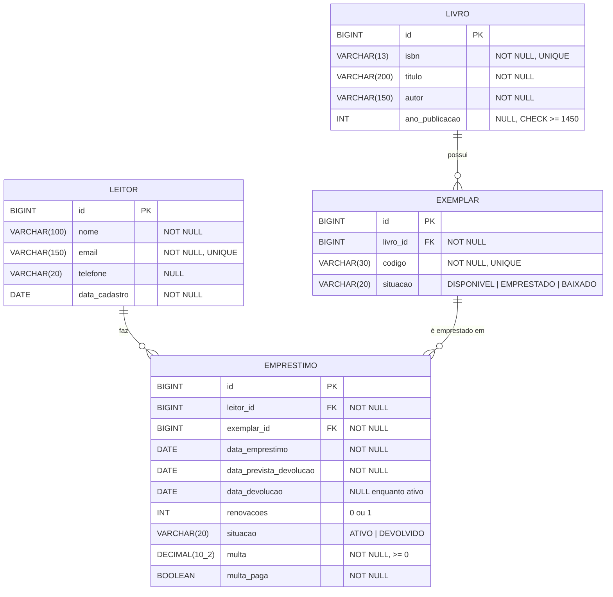

# Modelagem do banco de dados

## Diagrama entidade-relacionamento

## Cardinalidades

| Relacionamento | Cardinalidade | Explicação |
|---|---|---|
| Livro → Exemplar | 1 : N | Uma obra tem várias cópias físicas; cada exemplar pertence a exatamente um livro. |
| Leitor → Empréstimo | 1 : N | Um leitor faz vários empréstimos ao longo do tempo (no máximo 3 ativos ao mesmo tempo, regra de negócio). |
| Exemplar → Empréstimo | 1 : N | Um exemplar aparece em vários empréstimos ao longo do tempo, mas só em um ativo por vez. |

Leitor e Livro têm uma relação **N : N** que é resolvida pelo par Exemplar + Empréstimo:
o empréstimo é a entidade associativa, que guarda os dados do próprio vínculo (datas, multa, situação).

## Por que separar Livro de Exemplar?

O livro guarda os dados bibliográficos (ISBN, título, autor), que são iguais para todas as cópias.
O exemplar é a cópia física que é emprestada e tem situação própria. Sem essa separação, o título e o autor
se repetiriam a cada cópia, e não seria possível saber *qual* cópia está com cada leitor.

## Do objeto à chave estrangeira

| Objeto Java | Mapeamento JPA | Banco |
|---|---|---|
| `Exemplar.livro` | `@ManyToOne @JoinColumn(name = "livro_id")` | `exemplar.livro_id` → FK para `livro.id` |
| `Livro.exemplares` | `@OneToMany(mappedBy = "livro", cascade = ALL, orphanRemoval = true)` | lado inverso: não cria coluna, usa `exemplar.livro_id` |
| `Emprestimo.leitor` | `@ManyToOne @JoinColumn(name = "leitor_id")` | `emprestimo.leitor_id` → FK para `leitor.id` |
| `Emprestimo.exemplar` | `@ManyToOne @JoinColumn(name = "exemplar_id")` | `emprestimo.exemplar_id` → FK para `exemplar.id` |
| `Leitor.emprestimos` | `@OneToMany(mappedBy = "leitor")` | lado inverso: usa `emprestimo.leitor_id` |

O lado `@ManyToOne` é o **dono** do relacionamento: é ele que tem a coluna da chave estrangeira.
O `@OneToMany(mappedBy = ...)` só permite navegar no sentido contrário (ex.: `leitor.getEmprestimos()`).

## Restrições de integridade

- `ON DELETE CASCADE` em `exemplar.livro_id`: excluir um livro remove os exemplares dele
  (composição; a aplicação só permite isso quando nenhum exemplar tem histórico).
- `ON DELETE RESTRICT` em `emprestimo.leitor_id` e `emprestimo.exemplar_id`: o banco impede apagar
  leitor ou exemplar que tenha histórico de empréstimos.
- `UNIQUE` em `leitor.email`, `livro.isbn` e `exemplar.codigo`.
- `CHECK` nas situações (`DISPONIVEL/EMPRESTADO/BAIXADO`, `ATIVO/DEVOLVIDO`), em `renovacoes` (0 a 1),
  em `multa >= 0` e na coerência das datas.
